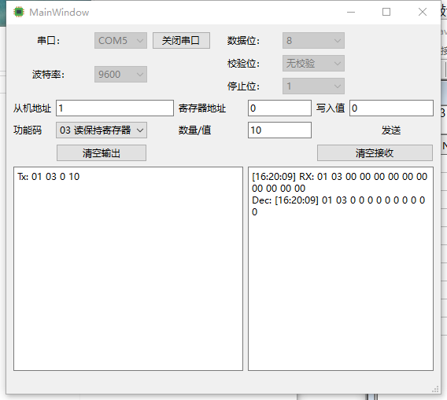

# Qt Modbus 调试工具

这是一个基于 Qt 6 开发的 Modbus 调试助手，支持通过串口使用 RTU 或 ASCII 协议，也支持 Modbus TCP。

## ✨ 主要功能

- 自动扫描并列出可用串口
- 支持配置波特率、数据位、校验位、停止位
- 支持 Modbus RTU、Modbus ASCII 和 Modbus TCP
- 支持 ASCII 纯文本串口收发（发送时自动追加回车符 CR；仅接受 ASCII 字符）
- 支持标准 Modbus 功能码：01、02、03、04、05、06、10
- 支持写单个线圈、写单个寄存器、写多个寄存器
- 实时打印发送（Tx）和接收（Rx）的内容；Modbus ASCII 模式显示冒号起始、LRC 校验和及 CRLF 结束符

## 📸 软件截图

## 🛠️ 编译与运行环境

- 开发环境：Qt 6.11.1 (MinGW 64-bit)
- 编译器：GCC 13.1.0
- 操作系统：Windows 10/11

## 🚀 如何运行

1. 安装 Qt 6.11.1 或更高版本（包含 MinGW 套件）。
2. 使用 Qt Creator 打开 `win.pro` 文件。
3. 配置编译器并构建运行即可。

## 👨‍💻 作者

- 杨磊
- 邮箱：l7369438033@163.com